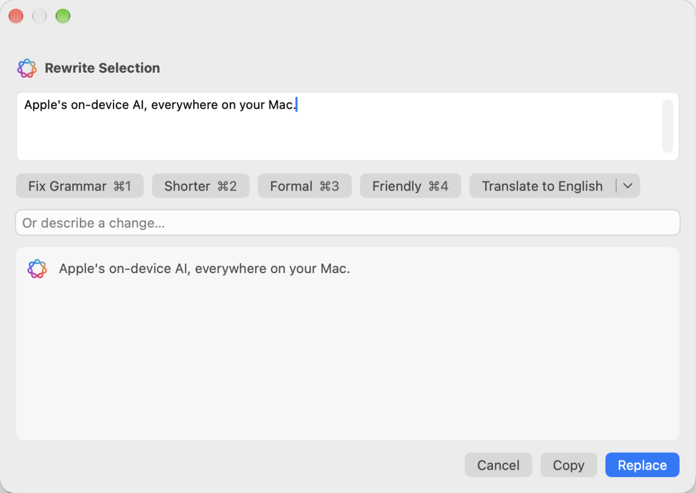
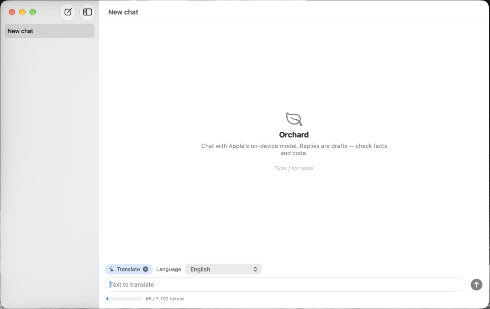

<p align="center"></p>

# Orchard

**Rewrite any text, in any app, with Apple's on-device AI.** Select text, press **⌃⌥R**, and fix the grammar, make it shorter, more formal or friendlier, or translate it. It all runs on your Mac with Apple Intelligence: no account, no cloud, nothing leaves your Mac.

<p align="center"><a href="https://github.com/iraosandeep/Orchard/releases/latest/download/Orchard.dmg"><b>⬇ Download Orchard for Mac</b></a><br>
<sub>Free · Apple Silicon · macOS 26.4 or later · Apple Intelligence turned on · <a href="#install">How to install</a></sub></p>

<p align="center"></p>

## Rewrite anywhere

Select text in any app, then:
- press **⌃⌥R**, or
- hover the **Orchard** leaf button that appears next to your selection, or
- right-click › **Services** › **Rewrite with Orchard…**, **Fix Grammar with Orchard** or **Translate with Orchard**.

<p align="center"></p>

Pick **Fix Grammar ⌘1 · Shorter ⌘2 · Formal ⌘3 · Friendly ⌘4 · Translate ⌘5**, or describe your own change. You can edit the text first. Press **⌘Return** to replace your selection, or **Copy** the result. Your clipboard is left as it was.

### Translate

One click translates into your default language (choose it in Settings), or pick another from the Translate menu.

## Also in Orchard

### Chat

A native chat window with streaming replies. Type **/** to run a task on your text: Summarize, Extract, Draft a reply, Translate, or any task from your `tasks.yaml`. **Return** sends, **Shift+Return** starts a new line, and **⌘N** starts a new chat. Set the instructions for all your chats in Settings › Chat Instructions. Chats are saved on your Mac.

<p align="center"></p>

## Privacy

Everything runs on your Mac through Apple's on-device model. Orchard has no account and sends nothing anywhere. The only network request is the daily update check against GitHub, which you can turn off in Settings.

## Install

You need an Apple Silicon Mac on macOS 26.4 or later with Apple Intelligence turned on.

### Download

1. **[Download Orchard.dmg](https://github.com/iraosandeep/Orchard/releases/latest/download/Orchard.dmg)**.
2. Open `Orchard.dmg` and drag Orchard onto the Applications folder.
3. Open Orchard from Applications. macOS says *“Orchard” Not Opened*. Click **Done**.
4. Open System Settings › Privacy & Security, scroll down, click **Open Anyway** next to Orchard and confirm.

Step 4 is needed once because Orchard isn't notarized by Apple. After that it opens normally, and updates install from inside the app.

### Or use Terminal

Paste this into Terminal. It installs Orchard into Applications, sets up the `orchard` command and opens the app, with no Open Anyway step:

```sh
curl -fsSL https://github.com/iraosandeep/Orchard/releases/latest/download/install.sh | sh
```

## First launch

Orchard lives in the menu bar as an outlined leaf icon. If something needs your attention, **Settings** (⌘,) opens and shows a one-click fix for each item:
- **Apple Intelligence:** turn it on in System Settings and wait for the model to download.
- **`fm` license:** read and agree to Apple's terms for the Foundation Models tool.
- **Accessibility:** needed so Rewrite can replace text in other apps.

Closing the window keeps Orchard running in the menu bar so the shortcut keeps working. Quit from the menu bar or with ⌘Q.

## Updates

Orchard checks for a new version on launch and once a day. When one is available it asks once, then keeps an **Update to …** item in the menu bar. Updates are only installed if they're signed by the same certificate as your copy. Running the install command again also updates.

## Tasks and the command line

For power users: summarize, extract fields, classify, or write a commit message from a diff:

```sh
pbpaste | orchard run summarize
git diff --cached | orchard run commit
echo "Invoice from Acme, Mar 3, $1,240" | orchard run extract -o "vendor, date, total"
```

Add your own tasks to `~/.orchard/tasks.yaml`; changes apply immediately:

```yaml
- name: classify
  label: Classify
  system: Classify the text into exactly one of these labels: {option}. Output only the label.
  option: { label: Labels, default: "bug, feature, question" }
```

Install the `orchard` command from Settings. Tasks also run in the browser: **Open Tasks in Browser** in the menu bar.

## Troubleshooting

- **"Apple Intelligence is off":** Settings › Open Settings…, turn it on, and wait for the download.
- **The Services items are missing:** apps load the Services menu when they start, so quit and reopen the app. You can also turn them on in System Settings › Keyboard › Keyboard Shortcuts › Services, and give them shortcuts there.
- **⌃⌥R keeps asking for Accessibility although Orchard is switched on:** click **Reset Permission** (in the prompt or in Settings) and switch Orchard on again.
- **The Orchard button stopped showing in an app:** you may have chosen "Don't Show in …". Settings › **Show in All Apps Again**.
- **"Safety filter declined this":** Apple's guardrails blocked the request. Try rephrasing.

## Feedback

[Report a bug](https://github.com/iraosandeep/Orchard/issues/new?labels=bug) · [Request a feature](https://github.com/iraosandeep/Orchard/issues/new?labels=enhancement) · [Release notes](https://github.com/iraosandeep/Orchard/releases)

Need help? Email [iraosandeep.dev@gmail.com](mailto:iraosandeep.dev@gmail.com).

You can also use **Settings › Help & Feedback**, which fills in your Orchard and macOS versions for you. Building from source or contributing? See [CONTRIBUTING.md](CONTRIBUTING.md).
