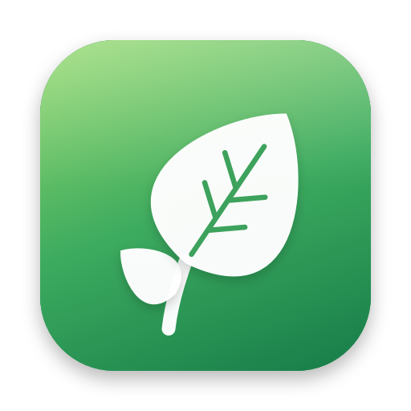

<p align="center"></p>

# Orchard

A local, private front end for Apple's on-device Foundation Model. **Orchard.app** has a native chat window, rewrites selected text in any app, runs one-click text tasks in the browser, and includes a CLI for scripts and git hooks. Nothing leaves your Mac.

## Install

```sh
curl -fsSL https://github.com/iraosandeep/Orchard/releases/latest/download/install.sh | sh
```

This downloads the latest release, installs `Orchard.app` into `/Applications` (or `~/Applications`), links the `orchard` command, and opens the app. You need an Apple Silicon Mac on macOS 26.4 or later with Apple Intelligence.

**Updates:** Orchard checks GitHub for a new release on launch and once a day. Turn this off in Setup & Status. When there's an update it asks once, then keeps an **Update to …** item in the menu bar. Install it from there, from Setup & Status, or with **Orchard › Check for Updates…**. The update is downloaded, checked to be signed by the same certificate as your installed copy, swapped in, and relaunched. Running the install command again also updates.

Orchard isn't notarized by Apple. Downloading `Orchard.zip` in a browser works too, but the first launch needs System Settings › Privacy & Security › **Open Anyway**. The command above avoids that.

## Build from source

```sh
./build.sh          # builds Orchard.app (needs Go + Xcode Command Line Tools; full Xcode not required)
open Orchard.app    # or drag it to /Applications and add it to Login Items
```

When Orchard opens it:

1. Checks that Apple Intelligence is on, and that the `fm` tool is installed with its license agreed.
2. Starts the bundled Orchard server (web Tasks UI and API on `http://127.0.0.1:1977`).
3. Has that server start `fm serve` (`127.0.0.1:1976`) and restart it if it ever dies.
4. Registers the Rewrite Selection shortcut (⌃⌥R) and adds a 🍃 menu-bar item.

If anything needs your attention, **Setup & Status** (⌘,) opens automatically:

| Check | If it fails |
| --- | --- |
| Apple Intelligence | **Open Settings…** goes straight to Apple Intelligence & Siri. macOS doesn't let apps turn it on, so switch it on there. Orchard notices within a few seconds once the model has downloaded. |
| `fm` tool | Ships with macOS 26 and later at `/usr/bin/fm`. |
| `fm` license | **Review & Agree…** opens `fm license` in Terminal so you can read and accept the terms yourself. `fm serve` won't run until you do. |
| Orchard server | Shows Running/Stopped with a **Start/Restart** button. Log: `~/.orchard/orchard.log`. |
| Accessibility | Needed only for Rewrite Selection. **Allow…** opens the right Settings pane. |
| Command line | **Install** links `orchard` into `/opt/homebrew/bin`, `/usr/local/bin` or `~/.local/bin`. |

Quitting Orchard (⌘Q or from the menu bar) stops the server and any `fm serve` it started. Closing the window doesn't quit; the app keeps running in the menu bar so the shortcut keeps working.

## Features

### Chat (native window)
- SwiftUI chat that calls `FoundationModels` directly, so it works even when `fm serve` is down.
- Streaming replies, markdown, copy, and a per-chat system prompt (toolbar button). ⌘N starts a new chat.
- History is trimmed from the oldest turn using exact token counts. The native API gives an **8,192-token** context, versus 4,096 through `fm serve`. A meter shows usage.
- Chats are stored in `~/.orchard/orchard.db`, shared with the web UI.

### Rewrite Selection (⌃⌥R by default, any app)
1. Select text anywhere and press ⌃⌥R.
2. Pick **Fix Grammar / Shorter / Formal / Friendly** (⌘1–4) or type your own instruction.
3. Press ⌘Return to replace the selection. Your clipboard is restored afterwards.

To change the shortcut, open Setup & Status › Rewrite Selection, click it and press a new combination; it needs at least two modifier keys, or use a function key. **Reset** restores ⌃⌥R. Selections over 6,000 characters are refused rather than cut off. Rewrite uses Apple's permissive guardrails for transforming text you supply, so ordinary text is rarely blocked.

### Tasks (browser)
Open **Tasks in Browser** from the menu bar, or go to `http://127.0.0.1:1977`. Paste text and pick a task:

| Task | Output |
| --- | --- |
| Summarize | 3–5 bullets |
| Extract | JSON with the fields you list (validated, retried once) |
| Rewrite | Shorter, formal or friendly |
| Commit message | One conventional-commit line from a diff |
| Classify | One label from your list |

Input over budget is truncated, with a visible warning.

### CLI
Install it from Setup & Status, or use `Orchard.app/Contents/Resources/orchard` directly.

```sh
orchard tasks                                  # list presets
pbpaste | orchard run summarize
git diff --cached | orchard run commit
echo "Invoice from Acme, Mar 3, $1,240" | orchard run extract -o "vendor, date, total"
echo "hey send it asap" | orchard run rewrite -o formal
```

`orchard run` starts `fm serve` if it isn't running and leaves it up, so the next call is fast.

Git hook (`.git/hooks/prepare-commit-msg`, made executable):

```sh
#!/bin/sh
[ -z "$2" ] && git diff --cached | orchard run commit > "$1"
```

The Go binary also runs standalone, without the app: `orchard serve [-addr 127.0.0.1:1977] [-open] [-no-fm]`.

## Custom tasks

Presets live in `~/.orchard/tasks.yaml`. It's written with the defaults on first run and re-read on every request, so edits apply immediately.

```yaml
- name: classify
  label: Classify
  system: Classify the text into exactly one of these labels: {option}. Output only the label.
  option: { label: Labels, default: "bug, feature, question" }
- name: commit
  label: Commit message
  system: Write one conventional commit line for this diff. Output only the line.
  max_input_chars: 6000
```

`{option}` is replaced by the option value. Add `json: true` to validate the output as JSON and retry once.

## How it fits together

```
Orchard.app (Swift)
├─ Chat window ──────────────┐
├─ Rewrite Selection ⌃⌥R ────┴─ FoundationModels (on-device, 8K context)
├─ Menu bar + Setup & Status
└─ Resources/orchard (Go) ── serve ── web Tasks UI + API ─┐
                             run   ── CLI ────────────────┴─ guard ── fm serve (4K context)
```

The Go **guard** (`guard.go`) makes every `fm serve` request safe: plain string content, no tools, input trimmed to a 3,000-token budget (chars ÷ 4), and SSE parsed whether or not streaming was requested.

| Path | What |
| --- | --- |
| `main.go`, `server.go`, `guard.go`, `tasks.go`, `store.go`, `fm.go` | Go server, CLI, guard, presets, SQLite, fm serve supervisor |
| `web/` | Embedded web UI (plain HTML/CSS/JS, no build step) |
| `mac/` | SwiftUI app: chat, rewrite, menu bar, setup, services |
| `build.sh` | Builds `Orchard.app` with the Go binary bundled inside |
| `mac/icon/make-icon.swift` | Draws the app icon (`AppIcon.icns`, `docs/logo.png`, `web/icon.png`); run `swift mac/icon/make-icon.swift` after editing |

## Releasing

```sh
./release.sh v0.3.0 --dry-run   # build + zip into dist/
./release.sh v0.3.0             # also tag and publish a GitHub release (Orchard.zip, install.sh, SHA256SUMS)
```

Always release from a Mac that has the "Orchard Local Code Signing" identity, or set `ORCHARD_SIGN_ID`, so users keep their Accessibility grant across updates. Back up that certificate (Keychain Access › export .p12).

## Configuration

| Env var | Default | Used by |
| --- | --- | --- |
| `ORCHARD_HOME` | `~/.orchard` | DB, `tasks.yaml`, logs |
| `ORCHARD_FM_URL` | `http://127.0.0.1:1976` | Go server/CLI |
| `ORCHARD_ADDR` | `127.0.0.1:1977` | App (server address) |

Everything binds to loopback only.

## Troubleshooting

- **Chat says Apple Intelligence is off:** use Setup & Status › Open Settings, turn it on, and wait for the model download.
- **Tasks show a red dot:** `fm serve` is down. Check that the `fm` license is agreed in Setup & Status, then look at `~/.orchard/fm.log`.
- **⌃⌥R keeps asking for Accessibility even though Orchard is switched on:** that toggle belongs to an older build. Click **Reset Permission** (in the prompt or in Setup & Status) and switch Orchard on again. `build.sh` signs with a stable local certificate ("Orchard Local Code Signing", created once in your login keychain), so the grant survives later rebuilds. Set `ORCHARD_SIGN_ID` to use your own Developer ID instead.
- **"Safety filter declined this":** Apple's guardrails blocked the request. Try rephrasing.
